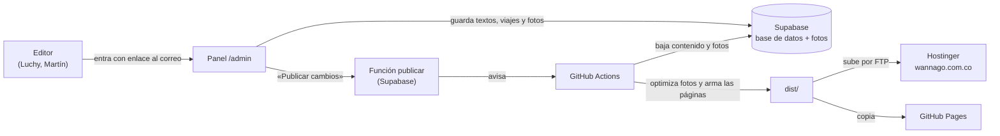

# Wanna Go Colombia · sitio web y panel de edición

Sitio de la agencia de turismo receptivo **Wanna Go Colombia** (Medellín) con su landing **Marruecos entre mujeres**, y un panel para editar textos, fotos y viajes sin tocar código.

| | Dirección |
|---|---|
| Sitio (en Hostinger) | https://wannago.com.co/ |
| Landing de Marruecos | https://wannago.com.co/marruecos/ |
| Panel de edición | https://wannago.com.co/admin/ |
| Panel en modo demo (no guarda) | https://wannago.com.co/admin/?demo |
| Copia en GitHub Pages | https://feliperpovera.github.io/wannago/ |

Contexto del cliente, manual de marca y pendientes: [docs/CONTEXTO.md](docs/CONTEXTO.md).

---

## Cómo funciona



1. **El panel** (`/admin`) guarda en **Supabase** lo que se edita: textos de cada página en español e inglés, viajes de temporada, cuadros de Colombia, destinos y fotos.
2. **«Publicar cambios»** le pide a GitHub que construya el sitio.
3. **GitHub Actions** baja el contenido de Supabase a `contenido/` (queda una copia versionada en el repositorio), optimiza las fotos y arma todas las páginas en `dist/`.
4. La acción sube `dist/` a **Hostinger** por FTPS (wannago.com.co) y deja una copia en GitHub Pages. El sitio es estático: carga rápido y Google lo lee completo. Tarda de 2 a 3 minutos en verse.

Además, la acción corre **cada mañana a las 6:00 a. m.** (para cambiar solo el viaje de temporada cuando pasa su fecha) y con **cada cambio que se sube** al repositorio.

> **Estado:** Supabase conectado (proyecto WannaGo) y sitio publicado en Hostinger. Editor: wannagoco@gmail.com. Falta el token de GitHub para el botón «Publicar cambios» (paso 6 de abajo).

## Estructura

```
wannago/
├── contenido/              Lo que edita el panel (copia de Supabase)
│   ├── paginas/            Un archivo por página: inicio, nosotros, contacto, pop-up…
│   ├── destinos/           Un archivo por destino (guatape.json, tayrona.json…)
│   └── viajes.json         Viajes de temporada y cuadros de Colombia
├── fotos/                  Fotos originales (las optimiza la construcción)
├── publico/                Archivos fijos del sitio
│   ├── css/                marca.css, menu.css, wa.css, carrusel.css
│   ├── js/                 marca.js, i18n.js (español ⇄ inglés), wa.js, resenas.js, carrusel.js
│   ├── fuentes/            Montserrat
│   └── marruecos/          Landing de Marruecos (HTML hecho a mano)
├── panel/                  Panel de edición, se publica en /admin
│   ├── esquema.js          Secciones y campos editables de cada página
│   ├── panel.js · panel.css
│   └── config.js           URL y clave pública de Supabase (por llenar)
├── herramientas/
│   ├── generar.mjs         Arma todas las páginas en dist/
│   ├── fotos.py            Convierte las fotos a WebP (800 y 1600 px) + imagen para compartir
│   └── supabase/           bajar.mjs (Supabase → contenido/) y semilla.mjs (contenido/ → Supabase)
├── supabase/
│   ├── migrations/         Tablas, permisos (RLS) y almacenamiento de fotos
│   ├── functions/publicar/ Botón «Publicar cambios»
│   └── seed.sql            Contenido inicial (lo escribe semilla.mjs)
├── docs/CONTEXTO.md        Cliente, marca y pendientes
├── .github/workflows/      Construir y publicar
└── dist/                   El sitio construido (no se sube; lo arma GitHub)
```

## Trabajar en local

Requiere Node 20 o más y Python 3 con Pillow (`pip install pillow`).

```bash
npm run construir
```

```bash
npm run ver
```

Luego abre http://localhost:8765 para el sitio y http://localhost:8765/admin/?demo para el panel.

## Qué se edita en el panel

| Sección | Qué permite |
|---|---|
| **Páginas** | Inicio, Nosotros, A la medida, Viajes grupales, Eventos corporativos, Destinos, Contacto y Pop-up. Cada una con sus mismas secciones y en el mismo orden del sitio: textos en español e inglés, fotos y textos para Google. |
| **Viajes de temporada** | La fila de viajes destacados. Sale el primero activo cuya fecha «hasta» no haya pasado; al día siguiente entra el próximo solo. |
| **Cuadros de Colombia** | Qué destinos salen en el inicio, en qué orden y con qué aviso. |
| **Destinos** | Editar, crear (con su propia página) y borrar destinos. |
| **Blog** | Escribir entradas con foto, en español e inglés, como borrador o publicadas. Cada una tiene su página en `blog/<url>/`. Formato sencillo: `## subtítulo`, `**negrita**`, `*cursiva*`, `- lista`, `> cita`, `[texto](enlace)`. |
| **Solicitudes** | Lo que llega por los formularios (se conectan cuando esté la política de datos, Ley 1581). |
| **Publicaciones** | Historial del botón «Publicar cambios». |

**Fijo a propósito** (para no romper el diseño): menú, pie, colores, formulario, canales de contacto y orden de las secciones. Para volver editable algo nuevo: agregar el campo en `panel/esquema.js`, en el archivo de `contenido/paginas/` y en la plantilla de `herramientas/generar.mjs`.

**Todavía en el código:** las reseñas de Google (`publico/js/resenas.js`), los datos de contacto y la landing de Marruecos.

## Seguridad

- **Acceso al panel:** correo y contraseña. Cada editora crea su propia contraseña desde el correo de invitación (o con «Olvidé mi contraseña»); nadie más la conoce. Solo entran los correos de la tabla `editores`. Enlace «Panel» en el pie de todas las páginas.
- **Permisos en la base (RLS):** el público solo lee lo publicado y puede enviar formularios. Solo los editores escriben, suben fotos y leen solicitudes. Probado contra Postgres con las políticas reales.
- **Claves:** en el repositorio solo va la clave pública de Supabase (`panel/config.js`). La clave `service_role` y el token de GitHub nunca se suben.

## Hostinger

- Sitio PHP/HTML `wannago.com.co` en el plan Premium. El usuario FTP entra directo en `public_html`.
- GitHub: variable `FTP_SERVIDOR` y secretos `FTP_USUARIO` y `FTP_CLAVE`. Para dejar `public_html` igual al sitio (borra lo que sobre): Actions → Construir y publicar → Run workflow → «limpiar_hostinger».
- DNS: el dominio usa los servidores de Hostinger (`pixel.dns-parking.com`, `byte.dns-parking.com`). SSL de por vida de Hostinger.

## Conectar Supabase (ya hecho; referencia)

1. Crear el proyecto en Supabase (región São Paulo, la más cercana).
2. Aplicar en orden los archivos de `supabase/migrations/` (esquema inicial y blog) (SQL Editor, o con la herramienta de Supabase desde Claude).
3. Cargar el contenido actual: `npm run semilla`, poner los correos de los editores en la última línea de `supabase/seed.sql` y ejecutarlo. Subir las fotos: `SUPABASE_URL=… SUPABASE_SERVICE_ROLE_KEY=… npm run semilla -- --fotos`.
4. Authentication → URL Configuration: Site URL y Redirect URL `https://feliperpovera.github.io/wannago/admin/`. Invitar a cada editor en Authentication → Users.
5. Correos: configurar un SMTP propio en Authentication → Emails (el envío que trae Supabase tiene un límite bajo por hora).
6. Desplegar la función `publicar` con los secretos `GITHUB_REPO` = `feliperpovera/wannago` y `GITHUB_TOKEN` (token fine-grained solo de este repositorio, permiso *Contents: Read and write*).
7. Llenar `panel/config.js` con la URL del proyecto y la clave pública (anon o publishable).
8. En GitHub → Settings → Secrets and variables → Actions → **Variables**: `SUPABASE_URL` y `SUPABASE_ANON_KEY`.

## Antes de salir en vivo

- Google: el sitio ya está abierto (`INDEXAR = true`). La landing de Marruecos sigue fuera (lista `BORRADORES` en `herramientas/generar.mjs`): quitarla de ahí cuando tenga precios y fechas reales.
- Quitar la franja de BORRADOR y los datos marcados «por definir» de la landing de Marruecos.
- Ver la lista completa en [docs/CONTEXTO.md](docs/CONTEXTO.md#6-pendientes).
